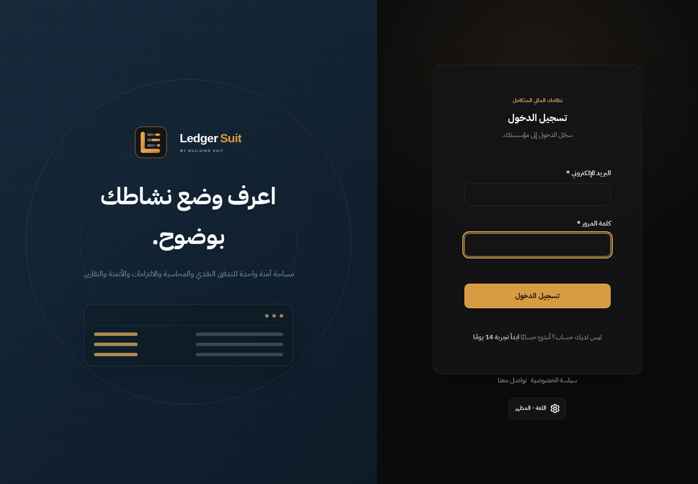
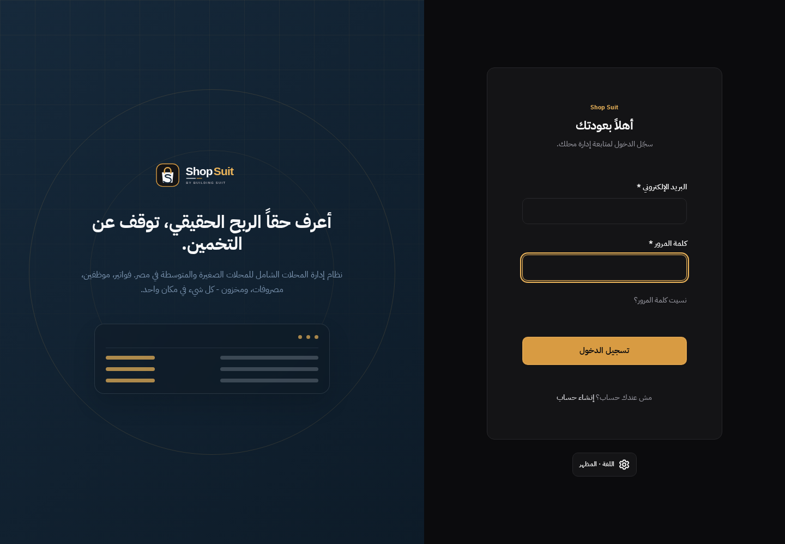

# Sign-in parity: settled focus states

Post-merge run [38518423963](https://github.com/Building-Suit/building-suit-monorepo/actions/runs/38518423963) failed only the Arabic/dark/1440 sign-in geometry comparison. Ledger's sampled email border was Gold; Shop's was neutral. All other sampled properties were equal. This is a deterministic measurement repair, without production UI changes or golden-screenshot updates.

## Reproduction and cause

The unchanged failing case reproduced twice in 20 focused repeats (18 passed). A same-render-frame probe showed the same behavior in both products: after email blur, email focus is false and password focus is true, but email's border is still `rgb(235, 180, 90)` with running CSS transitions at time zero. After the render frame advances, both have the neutral `rgb(39, 39, 42)` border and no active transitions. The reduced-motion rule specifies 0.01ms; it does not synchronously complete a browser render frame. The old test compared a transient focused paint in one app with a settled idle paint in the other.

## Minimal correction

The shared test verifies keyboard focus and polls the actual border against the existing canonical focus/idle token before collecting geometry. Expected colors are normalized using a hidden temporary color probe; the input's style is never changed. Full geometry equality, keyboard order, overflow, pending/error and script-error assertions remain. No retries, fixed sleeps, palette/font/layout changes, production selectors, or weaker screenshot expectations are introduced.

The pinned official Anthropic frontend-design skill was read/applied: preserve the brief's original brand/type/token identity and visible keyboard focus. Actual synthetic Arabic/dark images were inspected; the email is neutral and the focused password retains Gold. Source screenshots and the broader Penpot reference gaps are unchanged.

## Validation and coordination

Both app builds pass. The corrected full 12-combination locale/theme/width matrix passed twice (24 cases), and the previously failing case passed 20 repeats. Lint and workspace/token boundaries pass. The focused runner uses only the two existing app servers. These tests use intercepted synthetic invalid credentials; no hosted Auth/data mutation is performed.

Billing #285 landed while this work was in progress. The correction incorporates its final staging merge `6b099c9b4f9f23179aaa0ada02356ac2eaa1ad72` normally. That delta changes pricing-card width only in the token source; auth templates/input/base CSS and focus/idle tokens are unchanged. Required CI validates the final combined branch, without repeating unrelated design work. This correction adds no migrations or billing edits; hosted updates, main and production are excluded.

