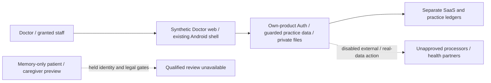

# DOS-M7-001 — Controller/processor and legal-policy review

Independent evidence preparation starts from published PR501/head `88252710f83e888b51e6f5ec5498bd5e320cfa37`, a clean committed parent. Owner continuation authorizes independent synthetic engineering/evidence packets; genuine legal/healthcare review, approved policies and dependent real-data/provider/native action remain unavailable. The canonical nine packets/104 tasks/dependency graph are unchanged. This task does not declare M6 complete or grant any legal decision.

Prepare a concrete current Egypt-specific review packet that separates the doctor/practice, independently granted staff, patient, caregiver, SaaS operator and each external organization/processor. Technical ownership, email verification, synthetic consent/guardian status, subscription purchase and generated prose are not qualified legal role/basis or professional approval. Record the exact product/data-flow scope, required reviewer identity/qualification/date/validity, authoritative references, unresolved questions and private evidence references without collecting real identities or records here.

C01 qualified review is unavailable. C02's independent exact-candidate process must report an absent/unsigned/stale/scope-mismatched receipt as unavailable or invalid; no human acknowledgement substitutes for evidence. C03 approved policy requirements and C04 accountable `DOS-M7-GATE-LEGAL` approval remain unavailable. Proposed responsibilities/questions can be prepared without calling them approved policies or certification. No actual legal opinion, entity registration, privacy contact, retention term, minor/guardian capacity rule, professional authorization or statutory notification deadline is invented.

This early draft contains the review scope only. Add structured technical facts, proposed review questions, policy/action matrix and a source-bound independent unavailable-receipt check, then push verified updates on the same PR. Do not fabricate product tests for a missing legal opinion. Continue independent M7–9 work under the existing synthetic dependency amendment while dependent capabilities stay blocked.

Parent501 local evidence:12 owned/96 focused cases, all8 typechecks/builds and141-route/80-preserved-migration strict boundaries pass; sourcec698 root2548/2471pass/54 inherited Shop failures/23skip. Broad lint12 Doctor/2 Shop errors and qualified financial/commercial/tax review remain held. Parentc724 SQL job succeeds; own010 actual full journey/independent financial review and browser acceptance remain unqualified. Source-specific verification records distinguish every failed/unrun receipt; full CI/root401 consolidation stays blocked.

No real patients/funds, hosted migration, provider/Automation activation, new native/provider/live dependent action, SDK/device runtime locally, purchase/signing/distribution/deployment or staging/main promotion. Only public legal-reference discovery is permitted here; discovery is not current qualified review, government registration or certification. Continue autonomously without asking for routine acknowledgements or treating a prepared packet as approval.

## Review packet and technical scope

[The structured packet](dos-m7-001-packet.json) separates seven participant scopes and eight logical data flows. Every legal entity, role, basis, actual hosting region and real-data approval remains unassigned. Technical facts are bound to the evaluated source: stored doctor/clinic grants, separate patient relationships, purpose/version consent checks, memory-only caregiver preview, unavailable privacy fulfillment and distinct financial ledgers. They are facts for a qualified review, not legal conclusions.

| Participant | Review evidence needed |
|---|---|
| Doctor/practice | Exact supplier/entity, professional standing, clinical/record duties, purpose/basis and required registrations. |
| Independently granted staff | Actual relationship, instructions, confidentiality/training and access/termination responsibilities per doctor/clinic. |
| Patient | Identity/capacity, distinct care/admin/payment/outreach purposes and applicable rights handling. |
| Caregiver | Independently verified authority/capacity/scope/expiry/revocation and conflicts; technical review flags do not establish guardianship. |
| SaaS operator | Actual entity/residence and separate account, subscription, hosting/support purposes and contracts. |
| Every infrastructure supplier | Legal supplier/subprocessor, actual region/transfer, permitted purpose, retention, security and incident obligations. |
| External health organizations | Separate agreements, organization authority, disclosure basis and independently validated recipient scope before sharing. |

The diagram describes technical/proposed scopes. Repository production/staging Doctor project refs are blank; this does not verify external user-managed hosting state. The existing Android shell and fixed encrypted Auth exception do not approve clinical/native use, a region, chart caching or distribution. Clinical release, patient identity/caregiver, commercial/tax and provider approvals remain independent.

## Proposed policy questions and owner actions

The nine proposed questions in the packet cover notices/purposes, roles/instructions, identity/capacity/caregivers, clinical/professional duties, retention/holds/rights, suppliers/transfers/security, incidents/complaints, billing/tax and change review. Approved requirements, accountable policy owners and deadlines remain null. In particular, the packet supplies no arbitrary retention period, age/capacity threshold, statutory notification clock or consent basis.

The owner can hand the packet to a qualified current Egypt legal/healthcare reviewer, supply actual entity/processor/region/contracts through approved private references, and obtain a signed dated opinion bound to the candidate/data-flow hashes and exact reviewed purposes. The handback needs reviewer identity/qualification/independently verifiable authority, authoritative current references, approved requirements, unresolved actions and validity/change terms. No outreach or legal engagement was initiated by the agent, and no real identity/record belongs in this repository.

Public discovery found the [PDPC portal](https://pdpc.gov.eg/) and a [DPO guideline pointer](https://pdpc.gov.eg/assets/pdf-data/Guidelines/DPO.pdf). Direct web opens returned HTML/no readable document text; their contents/currency were not verified. Search snippets and third-party translations do not supply the required current authoritative or qualified review. The packet's qualified legal-text list remains empty. A reviewer must establish the actual applicable current instruments and professional obligations for the exact entities/data flows.

## Independent verification and unavailable criteria

The separate [verifier](dos-m7-001-verify.mjs) binds the exact committed parent/head, local source hashes, unchanged canonical packets, participant/data-flow scope and held actions. It rejects unsigned, expired, superseded, changed-scope/candidate and incomplete receipt probes. A well-shaped generated claim still lacks independently validated reviewer authority. Existing pure privacy/caregiver contracts reject invented policy/fulfillment/legal/live/foreign-patient claims; these probes do not execute a database, patient endpoint or legal review.

Run `node docs/work-packages/doctor-suit/implementation/dos-m7-001-verify.mjs --base 88252710f83e888b51e6f5ec5498bd5e320cfa37 --head <exact-current-committed-head>`. With no qualified receipt, a correctly bound run exits2 and reports C02 **unavailable**, while listing successful technical/document controls separately. Exit0/full legal acceptance is not fabricated. C01/C03/C04 also remain unavailable. Wrong source/parent/control inputs fail with exit1. Record actual receipts, commands and limitations, run exact-parent release provenance, then continue independent tasks without a routine human acknowledgement.

## Exact-source results

At sourcece01cb57ed0b016b956a9823e08e4cb424ca1c8e, independent execution840b79e6-17ad-4c5c-a365-db3497f51d25 verifies67 technical/document/negative controls and exits2 with C02 unavailable. The actual legal receipt is absent; C01/C03/C04 and the produced legal gate also remain unavailable/Open. A real but incorrect parent control exits1 and fails the canonical task/parent binding. The full source-specific receipt, hashes/argv/UTC times and negative-control results are committed in [verification](dos-m7-001-verification.json). Final publication is re-evaluated separately.

Diff hygiene,141-route/80-preserved-migration strict boundaries and unchanged9-packet/104-task source validation pass. Product bytes are identical to parent501; no dummy product test, runtime, hosted operation or full-root repeat is substituted for missing legal review. Parent54 inherited Shop failures and other known CI/lint holds remain. Continue independent002 hosting/flows and subsequent tasks without treating these controls as approved policy or qualified advice.

Preserving parent refresh: published501/33b28bac1e17d49148c2684167c2a9a92808dc07 retains the tested billing hydration/history guard, explicit financial report fields and owner/current-period-bound010 fixture. Combined root source5d:2550total/2473pass/54 inherited Shop failures/23skip; all8 static types/builds pass, existing lint/required-CI holds persist. Legal evidence in this task remains parent-identical product bytes and null genuine review/policy/approval. Old receipts retain their original source bindings; re-evaluate exact-source controls without inferring legal authority.
