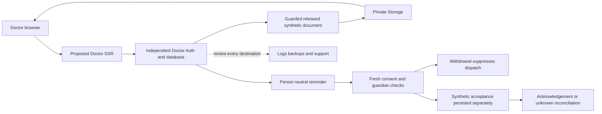

# DOS-M7-002 — Hosting, data-flow and transfer approval

Independent evidence preparation starts from published PR502/head `e62415f79b4d5a1b150024f7e8609df8e8ca7a07`, a clean committed parent. The canonical9 packets/104 tasks/dependencies remain unchanged. M7-001 qualified legal review and DOS-M7-GATE-LEGAL remain unavailable; the existing synthetic dependency amendment permits a concrete hosting inventory and review packet, without provider/native/live dependent implementation or provisioning.

Inventory proposed providers, actual-account/region/contract/subprocessor evidence, data categories/transfers and approved support access separately. Trace browser, existing synthetic Android shell, backend/Auth, private document Storage, neutral reminders, logs/analytics and backups. Distinguish account verification mail from patient outreach and SaaS settlement from patient money. Unknown region, unapproved subprocessor, unbounded support access or unexpected sensitive analytics blocks readiness; a public provider page/default does not establish the Doctor deployment or a signed/approved contract.

All four criterion approvals require accountable review. Actual Doctor supplier/account/region/contract/transfer and approved design evidence is absent. Prepare proposed traces and exact-source checks, while reporting C01–C04 and DOS-M7-GATE-HOSTING as unavailable/Open. Producing this document approves no host, territory, transfer or real-patient processing. The repository environment map's blank Doctor hosted refs is metadata, not verification of user-managed live state.

The concrete packet below contains document/reminder/log/backup/support traces, a structured evidence matrix and source-bound reject-unknown readiness comparison. No product/SDK/native/hosted configuration or dummy unit/database/browser test is introduced for missing approval. Public Supabase/Vercel region/DPA references are information for a qualified review; they are not customer-specific executed agreements or a legal determination.

Parent product bytes and source-specific checks are retained:141 complete routes/80 historical migrations/zero debt; root2548/2471pass/54 inherited Shop failures/23skip, known lint/required-CI holds. All legal/clinical/identity/caregiver/financial/tax/provider/offline/security/release approvals remain independent. Continue M7-003 onward and other independent M8–9 tasks without stopping at this checkpoint or inventing authority.

No real patients/funds, provider purchase/provisioning/activation, hosted migration, Automation mutation, dependent native/live action, SDK/device runtime locally, signing/distribution/deployment or staging/main promotion.

## Concrete processor and transfer inventory

The adjacent structured packet records13 distinct nodes and6 traces. Every actual supplier entity/account/region, verified subprocessor list, executed contract, transfer basis, retention, support authority and accountable approval remains `null`. Supabase and Vercel are proposed architecture, not approved Doctor deployments. Blank repository Doctor production/staging refs cannot establish user-managed live state. Shop/Ledger accounts, contracts, regions and credentials do not transfer to Doctor.

| Area | Proposed path and minimum necessary payload | Missing evidence / hold |
|---|---|---|
| Browser and SSR | Independent Doctor sessions; authorized projections and document references. No patient content or credentials in URL. | CDN/edge/SSR routing and actual access/error-log destinations, account, region and retention unverified. |
| Existing Android shell | OS encrypted Auth storage and Doctor session only. | No chart cache, offline write replay, new native SDK, clinical distribution or device approval inferred. |
| Auth/database | Independent Doctor project/environment; separate identity, relationship, encounter and independently granted staff access. | Actual entity/account/region, contracts and subprocessors absent. |
| Documents | Relationship/release authorization → guarded function → private Storage → fresh authorized download. | Storage/function/support/log destinations and approved document retention absent; synthetic bytes only. |
| Account mail | Account verification purpose only. | SMTP identity/account/regions/DPA not approved; verification is no patient outreach consent. |
| Patient reminders | Database outbox with current purpose consent/guardian checks; synthetic transport only. | External provider/account/channel absent; real delivery disabled. |
| Financial | Separate SaaS settlement and synthetic practice collection/refund ledgers. | No real beneficiary/transfer, financial review, tax invoice or provider authority. |
| Telemetry | Owned tests publish fixed IDs/status/phase/count/boolean source coordinates only. | Actual platform request/query/access/error logs and third-party analytics are unverified; no sensitive analytics/session replay approval. |
| CI/backups | Owned disposable fixtures and encrypted synthetic database recovery evidence only. | Artifact retention/access/transfers, hosted backup/replica region, Storage-byte restoration, RPO/RTO/schedule absent. |
| Support/partners | Proposed purpose-bound, time-limited, separately authorized and audited access. | No approved personnel/territory/subprocessor, break-glass mandate, healthcare transfer or operator clinical purpose. |

## Document and reminder traces

For a synthetic document, establish patient relationship and exact release/version before private Storage access. The actual source is `supabase/functions/doctor-documents/`; release, download, deletion and operator support remain separately scoped. A document URL or service credential is not an authorized clinical purpose. Proposed destinations include function/access logs, transient SSR memory, browser download, database references, Storage backups and support tooling; those actual host destinations remain unverified and must be enumerated before approval.

For a reminder, an appointment and purpose-specific contact/guardian decision create a persisted neutral outbox item. Withdrawal between persistence and dispatch suppresses the dispatch under M3's synthetic checks. Persisted synthetic acceptance remains separate from acknowledgement; reconciliation cannot blindly resend or invent delivery. External provider/account/channel is unavailable. Review any eventual transport's template/body minimization, destination, retry, callback, retention, support and subprocessor flows independently. A successful CI synthetic reminder does not establish legal consent, patient identity or notification delivery.

The existing caregiver preview is memory-only; it supplies no real patient/guardian endpoint. Existing Android Auth is a separate trace from future clinical patient-data transport. Account verification email and subscription settlement are separate purposes from outreach and patient money respectively.

## Approval and change control

C01–C04 all require genuine accountable review and are **UNAVAILABLE**. DOS-M7-GATE-LEGAL and DOS-M7-GATE-HOSTING remain OPEN. This is a prepared proposal and technical hold, not an accountable legal approval or rejection. Review must identify the exact candidate/flow digest, every actual entity/account and processing/support/backup/log location, signed applicable contracts, subprocessors, transfers, access/minimization/retention/deletion controls, authoritative jurisdiction-specific review, reviewer mandate/date and explicit scoped decision. Unknown region, new subprocessor or unexpected sensitive analytics blocks readiness and invalidates any prior scope until reviewed.

Public sources inspected2026-10-26: [Supabase region options](https://supabase.com/docs/guides/platform/regions), [Supabase public DPA](https://supabase.com/legal/customer-resources/data-processing-addendum) (version1, August1,2026), [Vercel network/regions](https://vercel.com/docs/regions), [Vercel public DPA](https://vercel.com/legal/dpa) (updated March17/effective March31,2026). These are public references for a reviewer; no customer-specific agreement, selected Doctor location, Egypt transfer permission or actual subprocessor approval is verified.

The local packet-readiness comparison binds committed inputs and rejects incomplete/scope-changed designs. Its successful control assertions with exit2 mean `unavailable`, never a human-review pass or an authorization to provision. No dummy product unit/SQL/browser tests stand in for the missing review. Product bytes remain parent-identical.
