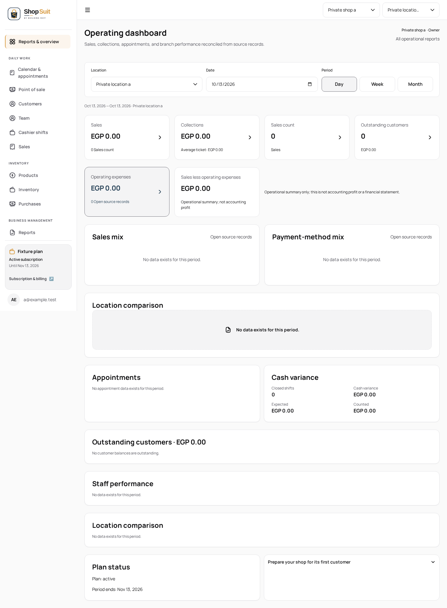
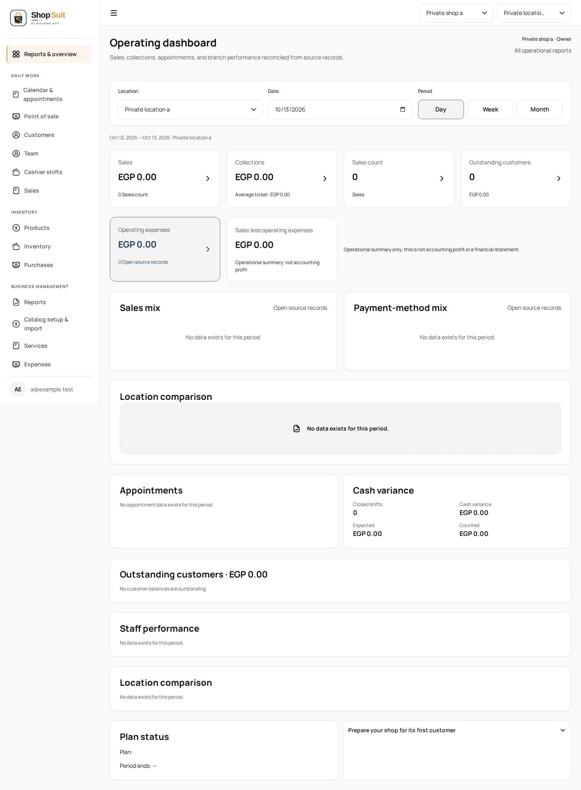
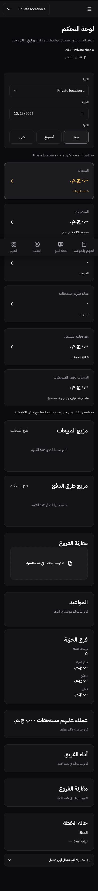

# Shop dashboard layout readiness

Independent navigation hotfix requested against staging `73a884b3da407696b3522771c94edb6e32ea7be6`; excludes the Penpot design stack and concurrent billing/SQL/SAS work. Branch: `codex/navigation/shop-dashboard-readiness`, parent: `stg`. No merge or deployment is authorized here.

## Finding and change

The private incident screenshot shows dashboard content under the marketing header. It is retained only in the cloud audit workspace, not published. A synthetic delayed-provider reproduction also produced the missing workspace with an active subscription: the router had committed `/dashboard`, while Nuxt's deferred route still referred to login. A deterministic actual-SFC unit regression selected `landing` instead of `default` before the fix. Missing subscription records are therefore not necessary for this reproduced shell failure; this does not establish the cause of hosted subscription errors.

Shop now selects presentation from the committed route family, retaining the existing public-route visibility gate and middleware. The shared root uses Nuxt's native `page-key`, scoped by route and account/tenant context, to remount the route leaf rather than the navigation host. Session-loss gating displays shared pending feedback without rendering protected content. Signup keeps its existing stable instance; account/tenant cache clearing remains intact.

No landing design, billing logic, auth middleware, provider settings, schema or hosted data changes. The finite shared layout-name boundary is typechecked across all six apps.

## Validation

- Actual-SFC signup/session transitions and shared foundation: 33 passed, including stale/deferred route metadata, signup continuity, tenant changes and session-loss privacy.
- New local browser fixture: 2 passed (English desktop/light and Arabic mobile/dark), each covering delayed shop/subscription reads, active and absent subscriptions, simulated billing read errors, refresh, direct navigation, repeated logout/login and anonymous redirect. The fixture performs no upstream requests.
- Existing logout/history privacy browser test: 1 passed. Its assertions are unchanged; the run allowed 60 seconds cumulative time.
- Six app typechecks, Shop production build, workspace/token boundary checks and changed-test/shared-root lint passed. Shop lint has two existing attribute-order warnings in owner-invitation.vue.

Synthetic browser evidence, inspected after capture:

The new browser cases have a 90-second cumulative timeout for repeated intentional provider delays; assertion timeouts are unchanged. Hosted staging has not been redeployed or verified by this work. CI remains the combined integration gate. Appointment design work remains parked in its separate unpublished worktree pending this checkpoint.

CI follow-up: the first full run passed 110 browser cases but failed the existing Shop signup frame check. The initial explicit route mapping incorrectly treated signup/password recovery like the self-framed login and invitation pages. Those three routes now retain their registered `auth` layout; actual-SFC coverage asserts that mapping despite stale route metadata. No authentication command or middleware changes are included. The failed CI run is retained as evidence, and the existing frame test and dashboard/logout cases are rerun on the corrected production build before publication.

Corrected-build results: existing Shop shared auth/public frame case passes (1), dashboard delayed/absent-subscription cases pass (2), and unchanged logout/history privacy case passes (1). All six consumer typechecks and 33 unit cases pass; Shop build passes. Public landing appears only in the unchanged frame regression, not as a design edit.
