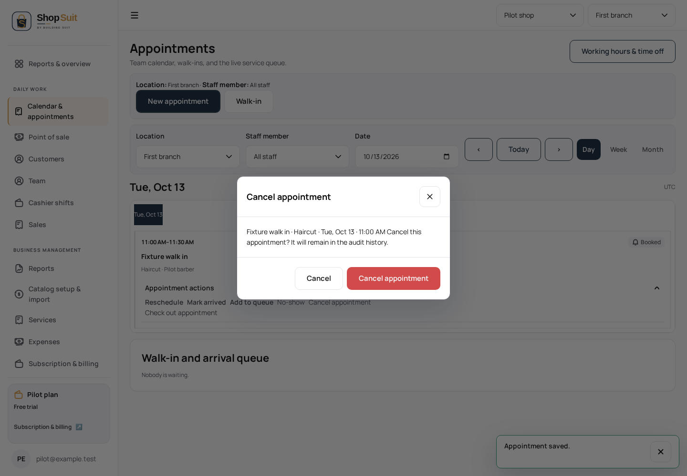

# Appointment action and recovery checkpoint

Parent #290 at `d8c66102c4274622852807be9a678c84c5a06ef3`; branch `codex/shop-suit/penpot-appointment-actions`. Review order #283 → #284 → #286 → #290 → this child. Independent #289 stays on its own branch; no hotfix commits are copied.

## Product changes and evidence

Saved cumulative delta `Shop-Suit-Penpot-Delta-2026-10-13-0408.json` describes edit/reschedule conflict, unavailable, invalid, failed and saving states, plus cancel/no-show/discard confirmations. Named confirmation IDs are `9d8c9265-2366-809c-8008-c81525b0f64f`, `9d8c9265-2366-809c-8008-c8152691e846` and `9d8c9265-2366-809c-8008-c81527697b6f`. There are no corresponding frozen PNGs; structured journeys are supported, visual fidelity is unverified.

Existing cancellation/no-show dialogs used generic confirmation labels and omitted appointment identity. They now identify customer, service, date/time and the exact localized action, with the existing shared danger presentation and cancel option. Shared UI/UX ownership is retained; no app composition is added.

Actual RPC-shaped error fixtures exposed a second product defect: plain structured error objects bypassed the `instanceof Error` message extraction, so overlap/unavailable/invalid errors displayed only generic failure. Appointment and schedule saves now safely extract a string message from object errors and apply their existing bounded localized classification. Arbitrary backend text is not rendered. Domain validation, RPC payloads and server permission/availability/idempotency policies are unchanged.

## Validation

Focused English desktop/light and Arabic mobile/dark journeys cover existing-identity prefill, reschedule time, overlap/unavailable/invalid/generic errors retaining inputs, pending save and Escape blocking, successful atomic payload, reopening, dirty cancel/confirmed discard and focus restoration. Each destructive action is first cancelled (no write), then confirmed with identity visible, exact scoped transition payload and terminal actions absent. Existing read-only/calendar and owner scheduling checkpoints remain in the parent. Exact final results are in the PR.

These are inspected synthetic implementation captures, not a reference comparison. No hosted data/settings, schema, deployment or merge changes. Landing, concurrent subscription/billing and shared auth/logout remain excluded.

Final results: 2 browser journeys passed, 6 calendar/appointment unit tests passed, Shop typecheck/build and workspace/token boundary checks passed. App and changed-test lint passed. The browser journey allows 60 seconds cumulative time with unchanged assertion timeouts. An initial fixture exposed the error-message defect; a subsequent locator correction reopened the disclosure after successful calendar refresh, rather than bypassing the existing action or focus checks. The final fixture also updates end time to preserve the service duration after rescheduling.

## Remaining review work and source limits

The 33-board inventory has one excluded landing route and six concurrently owned auth/billing routes. All **26 in-scope route matrices remain incomplete**. Three in-scope main pages have pixels (dashboard, POS and supplied Team specimen); **23 main-page references are absent**, including product/service directories (their dialog crops are available). Shell pixels are available separately. The frozen design source reports zero complete matrices; this checkpoint does not change that source fact.

Seven remaining review categories, not seven proven missing implementations: (1) appointment schedule feedback and further scope/responsive variants; (2) cash shifts and role/history contexts; (3) reports and customer allocation; (4) inventory/purchasing; (5) sales/receipts; (6) settings/admin; (7) public non-landing pages. Prior code/checkpoints exist in each category and should be inspected before adding work. Full appearance completion is blocked by absent visual exports. The delta explicitly says the cash closed/reconciled history design was **not saved**; do not claim that missing board is an approved design. Real hosted readiness remains separate from local UI fixtures.
