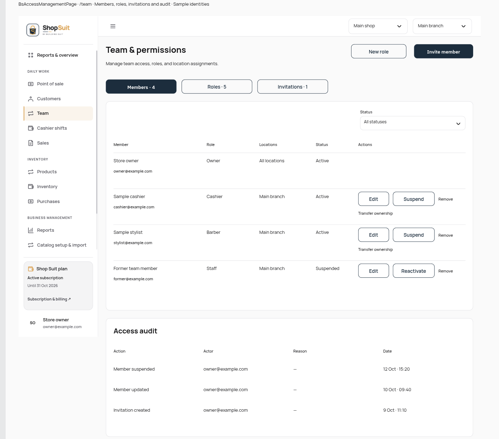
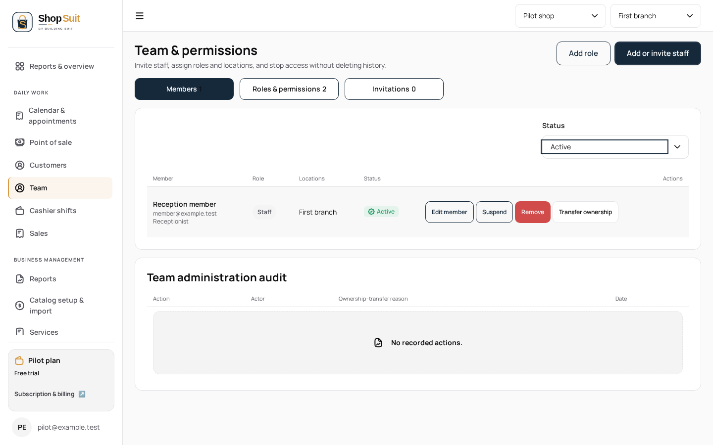
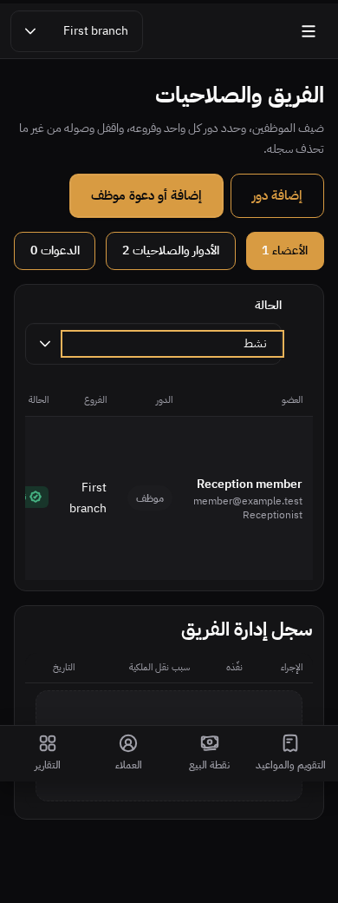

# Frozen design vs current staging audit — 13 October 2026

Baseline: `acec5545feaeaae8e7ab15cb970c6e48d72cca1b`, fetched from the authenticated GitHub `stg` branch. Initial checkout was stale (`main` at `9ab3ff7`); its fetch refspec fetched only `main`. An explicit `stg` fetch resolves this executor issue. It does not establish which commit the user's live application serves.

All 86 published commits listed in PR #278 are ancestors of this baseline, including tested head `dba77f151b5e562dbebc2808483848a9e8b76ae1`. Ten recorded earlier UI/cloud checkpoint heads (uploader through aggregate integration) are also ancestors of current `stg`. No omission from those published checkpoints is established. Existing route templates are present, but presence and previous behavioral checks do not prove design parity.

Sources: Library handoff `libfile_9359e8a23ab88191b9b297257d196aec`, cumulative delta `libfile_1d906b5c37608191b8a5afc386cd70c1`, and supplied Team design screenshot `libfile_64978aa4df3881919eaa6410516e887e`. All downloaded in this cloud executor with identity/version xattrs and inspected as readable ZIP, JSON and PNG bytes. Six actual images visually inspected. No live Penpot/home network access.

| Scope | Current evidence | Classification / action |
| --- | --- | --- |
| Shell | Frozen PNG; shared flat shell/official Shop logos already in staging | Integrated implementation; broader state parity unverified |
| Dashboard | Approved PNG; dashboard metrics/charts/template already integrated | Integrated implementation; retain approved design, broader parity unverified |
| POS | PNG; compact images, stepper and bounded cart already integrated | Integrated implementation; broader parity unverified |
| Product/service editors | Two PNGs; upload molecule/editors/private-media adapters already integrated | Integrated implementation; hosted media readiness separate from UI presence |
| Team | Newly supplied PNG shows outlined count tabs, separate member/audit panels, secondary new-role action; current template uses underline tabs, unframed member/audit sections and two primary actions | Concrete unimplemented visual differences; first bounded correction |
| Sales/receipts, directories, purchasing/customers, appointments/cash/expenses/reports, settings/admin, public non-landing | Saved board IDs/state metadata and existing route templates; corresponding PNGs absent from supplied ZIP/delta | Missing visual sources; inspect behavior independently, do not invent appearance or claim fidelity |
| Catalog import | Saved main/state metadata; tracker explicitly records no dedicated cloud fidelity checkpoint | Unfinished implementation/verification checkpoint; appearance blocked by missing pixels |
| Full variants | 33 main boards saved; zero full matrices complete; delta retains pending QA and explicitly unsaved cash closed-history view | Unfinished design source, not merge omission; absent boards are not designed screens |
| Billing/subscription and shared auth/logout | Concurrent tasks own these changes | Excluded until coordinated |
| Landing | Explicitly excluded | No implementation work |
| Live deployment | No live deployment commit or browser response inspected | Undetermined; cannot infer deployment failure from design screenshot |

The supplied screenshot itself is a design specimen: its top annotation identifies `BsAccessManagementPage /team` and sample identities. It is visual evidence of intended Team appearance, not proof of the live site's deployed SHA.

No frontend/UI SKILL.md exists in the selected workspace's `.agents` directory or repository; scoped AGENTS.md and maintained shared specifications govern this work. Original brand SVGs, tokens, AR/EN direction and domain/server logic are preserved.

## Team checkpoint

The shared Access page now uses token-backed outlined count tabs, a contrasting active tab, a secondary create-role action, a labeled end-aligned status filter, separate member/audit panels and restrained table headings. All product commands, permission gates, identity/role/location semantics and pending/dirty dialogs remain unchanged. This is a source-backed visual correction, not a full Team matrix completion or pixel-perfect claim. Sample data, copy, permission-dependent actions, status badges and shell navigation legitimately differ from the design specimen.

Validation: strict workspace/token boundaries pass; 1,400 unit tests pass with 23 gated skips; Shop and Ledger typechecks pass; scoped ESLint passes. Shop and Docs production builds pass. Twelve actual Shop Team cases pass (EN/AR, mobile/desktop, light/dark, denied/empty/acceptance). Twelve shared Access cases pass (Shop/Ledger, EN/AR, light/dark, 390/768/1440, keyboard tabs, dirty role dialogs, immutable member email). The final labeled-filter/table-header adjustment receives focused rebuilt browser verification; results/evidence recorded below when complete.

Tooling-only initial failures: preinstalled pnpm version mismatch, npm/browser caches outside writable roots, old gh without `--slurp`, and a nonexistent Docs package filter. Resolved with repository-pinned pnpm, cloud-local cache/browser paths/current gh and path-based Docs filter. Initial root tests lacked the selected browser path; rerun with it passed. No hosted fallback.

Final rebuilt checks: two actual-route Team cases (EN/light/1440, AR/dark/390) and two shared Access configurations (both Shop/Ledger consumers) pass after the labeled-filter/table-heading change. Rendered PNGs inspected: intended tab/action/surface/filter differences corrected; no horizontal page overflow. Desktop fixture has one member and empty audit, different copy and service-mode navigation; Arabic mobile table uses its existing internal horizontal scroll. These differences prevent whole-page pixel equivalence.

| Source desktop design | Implemented desktop fixture | Implemented Arabic/dark/mobile fixture |
| --- | --- | --- |
|  |  |  |

Publication parent is concurrent Shop logout #281 at `19eeff0ed62acd09c987c3a74a959ec7f036cc79`. Only its committed ancestry is inherited; no auth/logout file edits are included in the Team PR diff. No billing/subscription work copied.
