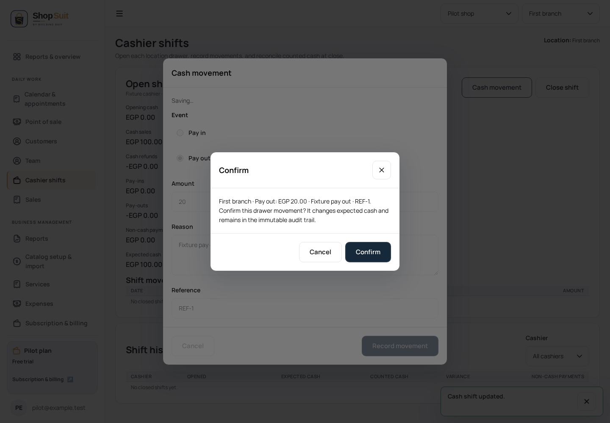

# Cash-shift action and read-state checkpoint

Parent #291 (`f055e50c016ed0e2e4460480f5d5b8dc1ee63c99`); branch `codex/shop-suit/penpot-cash-actions`. Review order #283 → #284 → #286 → #290 → #291 → this child. Independent #289 stays separate and is now fully green at `713a204` (run 38450748615). No merge, deployment or hosted mutation.

## Supported source and fixes

The frozen cumulative delta describes open/conflict/denied/pending, movement invalid/failed/pending/pay-out, close denied/failed/pending and zero-opening states. Main ID `9d8c9265-2366-809c-8008-c7fabe2292bb`; eleven saved state IDs run from `9d8c9265-2366-809c-8008-c81c49fc8890` through `9d8c9265-2366-809c-8008-c820470d2329`. They are metadata without PNGs. The proposed closed/reconciled history design was explicitly **not saved**. Existing implemented history is retained and tested, not restyled as an invented approved design.

Three bounded defects are corrected:

- Structured RPC errors became `[object Object]`, losing existing localized conflict/denial/invalid guidance. The adapter now safely extracts a string message and classifies it into existing copy. Arbitrary server text is not displayed.
- Consequence confirmations omitted the approved amount and context. They now name location/opening amount, movement direction/amount/reason/reference, or expected and counted cash, followed by existing consequences. Shared confirmation behavior and command boundaries remain unchanged.
- Retry displayed the previous error while a new read was pending. Shared pending feedback now takes precedence and suppresses tables until success. The manager history filter gains visible field labeling and its all-cashiers placeholder.

No money arithmetic, request-ID lifetime, transaction rules, scope cancellation, API contract, permissions or stored history changes. App code owns domain props/events; the shared template owns presentation. Original brand/tokens, EN/AR and direction remain intact. Landing, subscription/billing, shared auth/logout, reset SQL and SAS are excluded.

## Functional evidence

New EN desktop/light and AR mobile/dark browser journeys exercise native invalid money, zero opening, pay-out, all three confirmations cancelled without writes, structured command errors retaining input, retry preserving request IDs, successful scoped payloads, and closed history. Restricted cashier cases check other-cashier close/adjust absence, own-shift close capability, pending table suppression, failure/retry and no writes. No-shop/no-location contexts avoid cash reads/tables; history pagination and cashier filtering are verified and already reset to page one correctly, requiring no extra code change.

Existing twelve EN/AR × light/dark × 390/768/1440 open/pay-in/close command cases pass on the completed stable build with their assertions unchanged. An earlier overlapping rebuild invalidated one attempted browser run by removing built assets; that attempt is not counted as validation. The no-shop fixture initially prevented its own dashboard bootstrap; absence now starts after fixture setup, retaining no-context assertions. Exact final counts are recorded in the PR.

Synthetic implementation captures are inspected evidence, with no corresponding source PNG for comparison. UI checks do not establish hosted authorization or provider readiness.

Final local results: 10 new browser cases plus 12 unchanged owner-command cases pass, five cash unit cases pass, Shop typecheck/production build and workspace/token checks pass, and changed app/UI/test lint passes. The final production build is stable throughout the counted runs.

Concurrent publication note: independent payment hotfix #292 temporarily shares the `shop-suit` staging-root key with #283 and its owner is coordinating the supported base/stack resolution. The existing UI stack is preserved; no retarget, rewrite, deletion or UI merge is performed here. The child remains based on #291. This global policy conflict must be resolved and checked before integration; it is not a local cash test failure.

## Completion accounting

The supported local cash action/read-context/filter/pagination journeys are functionally reviewed, with further appearance comparison blocked by missing exports. This is not full pixel/state-matrix completion. Inventory/count/threshold/error flows, purchasing editor/payment flows and sales/receipt flows already have inherited verified checkpoints; do not reclassify those as missing UI because their PNGs are absent. Reports query/error/retry/export and customer allocation editor checks also exist; the full customer-profile lifecycle and settings matrix were explicitly incomplete and remain next review work.

See `shop-ui-functional-progress-2026-10-13.json` for implemented/tested/source-blocked distinctions. Appointment core edit/status/block/owner schedule journeys are covered by #290/#291 and inherited cases, while broader scheduling feedback/scope combinations retain a separate review flag. Four active review buckets remain: appointment scheduling variants, reports/customer-profile lifecycle, settings/admin completeness, and public non-landing contexts. Previously verified inventory/purchasing, sales/receipts and this cash checkpoint are retained as completed named journeys pending reference QA, not repeatedly reopened without a concrete defect.

All 26 in-scope route design matrices remain incomplete; 23 main-page PNG references are missing. The frozen source still has 33 saved main boards and zero complete matrices. Landing and the six concurrent auth/billing routes are excluded from those 26. Real hosted checks are separate and remain unclaimed.
