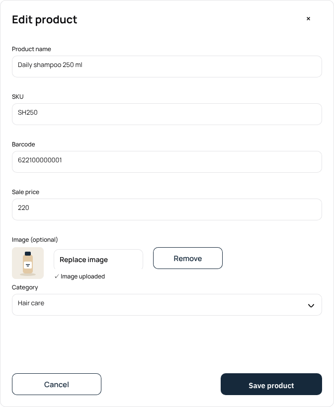
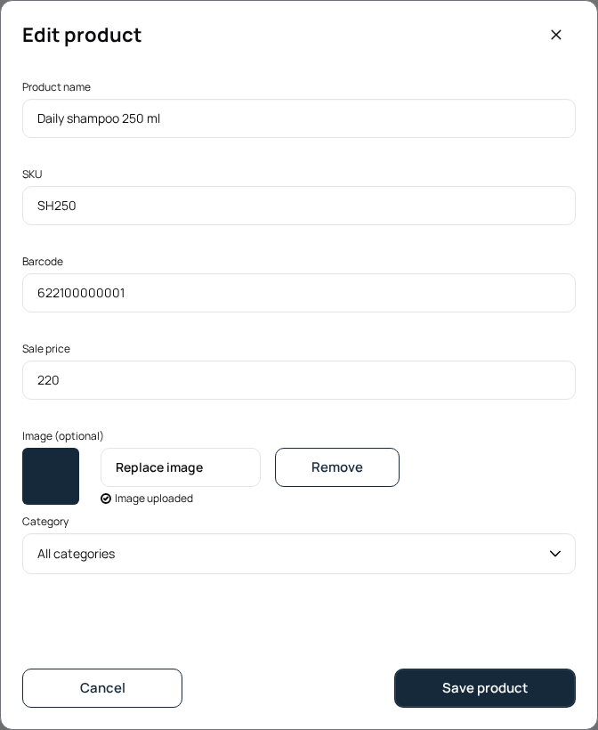
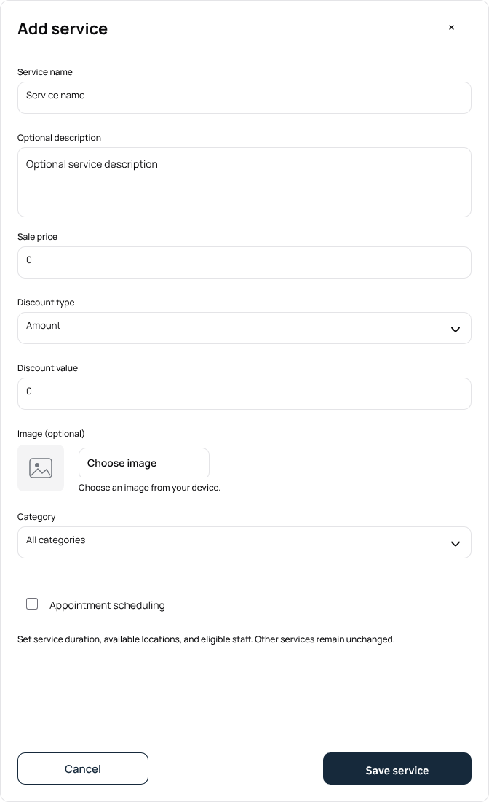
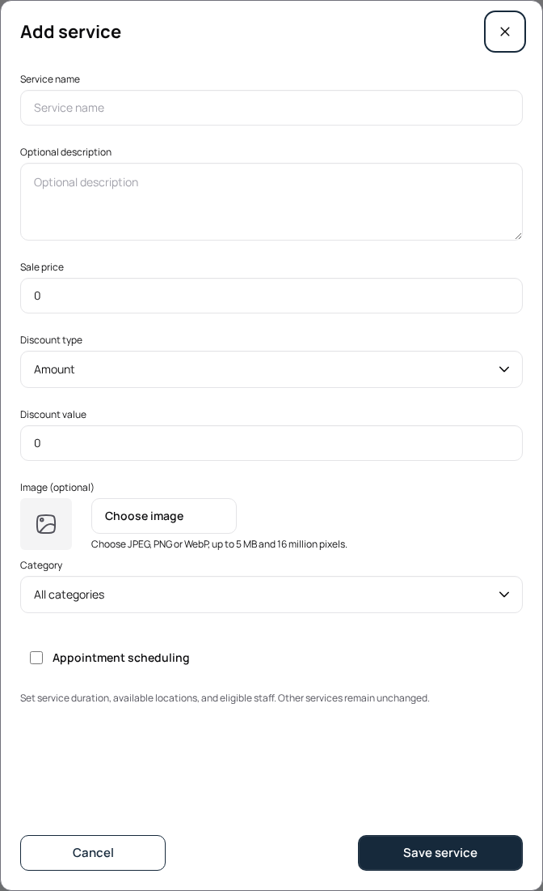
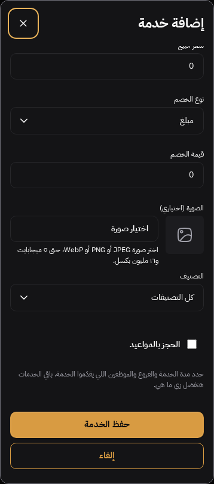

# Catalog dialogs — product edit and service create

Cloud-only continuation on `codex/shop-suit/penpot-catalog-dialogs`, stacked on #284. Current staging hotfix baseline: `73a884b3da407696b3522771c94edb6e32ea7be6`; #283 is now the Shop root into staging and #284 remains its child. History was merged forward locally and retained; no UI stack PR was merged.

Sources: materialized/readable frozen PNGs `04-product-edit-upload.png` (board `9d8c9265-2366-809c-8008-c7eb4e35b3e9`) and `05-service-create-upload.png` (board `9d8c9265-2366-809c-8008-c7ec24019bfc`). They are dialog references, not pixels for the complete Product/Service directory mains. All source bytes and Library metadata remain preserved in `/workspace/design-sources`.

Before: generic record-dialog heading/insets, narrow cancel/save and upload actions, large image/category separation, and an empty category selection displayed without a label. Prior service screenshot was edit mode. After: catalog-owned shared template geometry uses the reference 672px width, 24px insets, product/service minimum heights capped by viewport space, 180px cancel/choose and 204px save actions, 44px control targets, caption field labels, compact uploader/category grouping and readable existing All categories fallback. The uploaded state retains written feedback with a canonical check icon. Service create explicitly preserves unchecked scheduling, its explanation, and expandable duration/cleanup/location/staff controls.

All presentation stays in `packages/ui`; existing shared dialog/form/upload interactions remain in `packages/ux`; applications continue supplying values, content, capabilities and commands. No business, upload transport, security, billing, auth or landing changes. Optional media remains optional. Generic record dialogs outside the catalog template retain their geometry.

Verification: current Shop typecheck, production build, workspace/token boundaries and scoped lint; seven existing upload/media unit cases. Focused browser verification covers EN/light/1440 and AR/dark/390 create-mode native validation, category fallback, scheduling values/payloads, write failure/retry/pending/escape lock/success and dirty discard, plus existing edit/upload validation/failure/retry/preview/replacement/removal and two legacy catalog adapter journeys. Results and compared images appended after final checks.

Source-backed dimensions are compared rather than a claim of whole-image equality. Browser focus indicators, sample image/category data, native controls and validated file-restriction copy differ legitimately. No mobile/Arabic/dark dialog source PNG was supplied; these modes receive behavior/containment checks, not native variant pixel approval. All full design matrices remain incomplete.

Final verification: six distinct Shop browser cases pass on the reviewed runtime (two legacy edit/scheduling adapter cases, two create cases, two upload lifecycle cases), plus two Docs shared-pattern/mobile/keyboard cases. Shop and Docs production builds, Shop typecheck, seven upload/media unit cases, workspace/token checks and UI/test lint pass. A final Arabic create test initially raced the dialog's initial-focus transition; waiting for the observable initial keyboard focus corrected the setup, and both create cases pass with native invalid-field focus still asserted. No global interaction policy was changed.

The later typecheck also caught the prior Team optional-label type error. It was fixed on owning #283 (`1e13e07`) and propagated through #284 before this checkpoint; staging hotfix history is inherited. PR diffs remain feature-specific.

| Frozen product edit | Current product edit |
| --- | --- |
|  |  |

| Frozen service create | Current service create |
| --- | --- |
|  |  |

Remaining evidence gaps: complete directory main pixels; native responsive/language/theme dialog variants; real tenant-authorized Storage/save verification (no hosted writes permitted in this task). Illustrated source photography and category values are not fixture data. Full-state pixel equivalence is not claimed.
