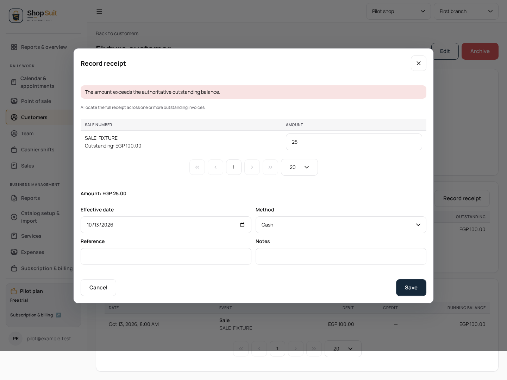
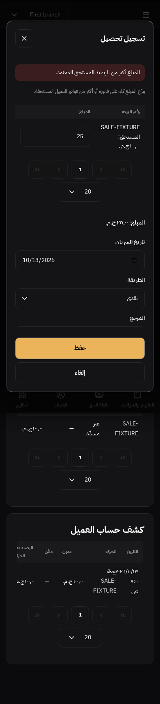

# Customer profile read and allocation checkpoint

Branch `codex/shop-suit/penpot-customer-profile`, committed parent #293 at `e5f4392`. Existing UI order: #283 → #284 → #286 → #290 → #291 → #293 → this child. #292/#283 ancestry is held; no retarget, rewrite or merge is performed. The known duplicate-root policy blockage is not bypassed or repeatedly rerun. #289 full CI is green at `713a204`.

## Source and concrete gaps

The cumulative delta records receipt allocated/saving/over-allocation/save-failed states `9d8c9265-2366-809c-8008-c80c8e30f04e`, `…c80c8eb47df6`, `…c80c8fe252ad`, `…c80c90f11a33`; archived/view-only `…c80cc29924da`, `…c80cc3e6e884`; not-found/denied/load/receivables/statement/empty feedback through `…c80ccdc91a7f`. These structured requirements are available; corresponding PNGs are not in the frozen sources. No design or pixel-parity completion is claimed.

The route already implements contact, receivables, statement, receipt allocation and lifecycle commands. This checkpoint corrects existing behavior:

- Failed/pending statement and overdue reads previously formatted defaults as zero balance/count. Only resolved summaries are now projected. Independently successful summary reads remain visible.
- Receivables and statement now show explicit shared pending feedback before old errors and suppress their tables until resolved. Receipt actions are unavailable while invoice reads are pending/failed; existing active-customer/payment capability gates also guard the semantic action and submission.
- Structured RPC objects previously bypassed `instanceof Error`, losing authoritative overpayment and identity/lifecycle guidance. Safely extracted messages use existing bounded localized classification; raw backend text is not rendered.
- Archive confirmation identifies the customer and exact action through shared confirmation UX. Archived/view-only/read-failure states retain their existing read-only presentation.

No allocation arithmetic, request-ID lifetime, validation helper, API/schema/transaction/permission contract changes. Domain projection/commands remain in the app; all composition is shared UI. Brand/tokens and EN/AR direction remain intact. Landing, concurrent billing/subscription/auth/logout, reset SQL and SAS are excluded. No hosted data/settings, deployment or merge changes.

## Verification

English desktop/light and Arabic mobile/dark cases cover failed/pending/retried statement and receivables, summary suppression, disabled receipt action while unavailable, native invoice maximum, structured overpayment retention/recovery, pending save/Escape blocking, exact scoped allocation payload, cancelled archive without mutation, successful archive and hidden writes. Archived/view-only/not-found/denied/load-failed/confirmed-empty states are exercised. Existing twelve allocation scenarios retain their assertions across EN/AR × light/dark × 390/768/1440. Final results are recorded in the PR.

These inspected captures use synthetic local fixtures without upstream requests. UI capability checks are not evidence of hosted authorization. Reference exports remain necessary for appearance comparison.

Results: 18 final state cases pass, nine receipt-allocation/payment-evidence unit cases pass, Shop typecheck/build and boundary/token checks pass, and changed app/UI/test lint passes. The twelve unchanged allocation scenarios passed before the final retry-only helper; the final read cases verify that helper recovers both invoices and overdue count. The initial Arabic retry tests used the wrong localized label; selectors now match the actual route's “حاول تاني” while all failure/pending/recovery assertions remain intact. No test timeout or error expectation was weakened.

## Remaining functional scope

Named customer-profile lifecycle/allocation/read-feedback journeys are reviewed; retain them as completed named flows rather than reopening because pixels are absent. Reports still require the saved collections/receivables/suppliers/expenses/inventory/margin/activity and access/cost-profit/export variants review. Other active buckets remain appointment scheduling variants, settings/admin completeness, and public non-landing contexts. Previously verified cash, inventory/purchasing and sales/receipt journeys remain complete within their recorded scope. Four review buckets remain, but the reports/profile bucket now excludes completed profile lifecycle work.

The independent progress file and original gap matrix distinguish implemented/tested/missing evidence. All 26 in-scope design matrices remain incomplete; 23 in-scope main-page PNG references are unavailable. Frozen source counts remain 33 main boards / zero complete source matrices. Cash closed-history design remains explicitly unsaved.
