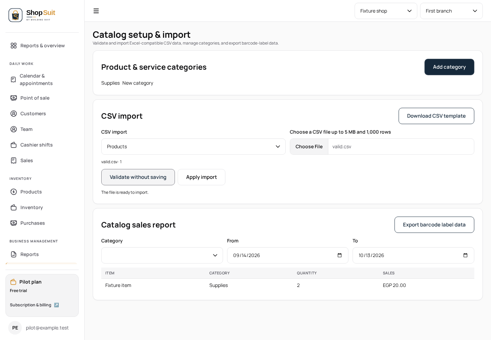
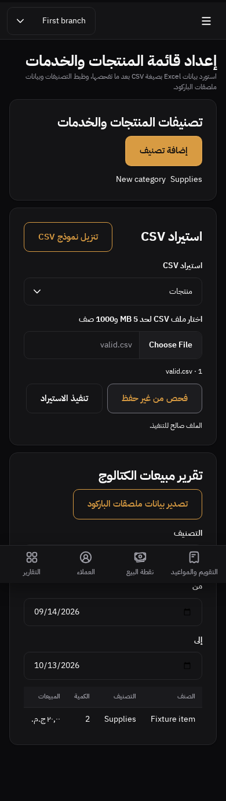

# Catalog import — frozen state requirements checkpoint

Cloud-only continuation from Team #283, parent `891619807a0e29a4f982b4b6c998137bcea42aec`. Route `/catalog-import`, saved main `9d8c9265-2366-809c-8008-c7fcdb94395d`.

The frozen route inventory calls for loading/no-shop, parsed file/row count, parse and row/field validation errors, pending/applied feedback, import kind/category/report filters, report loading/error/retry and export feedback. No corresponding PNG or rendered board data is supplied. This checkpoint implements verifiable state semantics using existing shared components; it does not claim the saved board's appearance or full variant parity.

Before: while shop context resolved the template displayed only its header; while a report loaded it displayed import `Validating…` text; category fields had no generated label/input association. After: context and report loading have accessible shared skeletons, unresolved context cannot expose stale content, and the category editor has a programmatic label/description relationship.

Preserved: CSV limits/templates, parser, immutable validated request ID, confirmation before applying, atomic import RPCs, tenancy/permission rules, category commands, financial calculations and exports. No domain, database, Storage, billing, auth or landing edits.

Browser additions exercise customer/supplier row errors, blocked apply, successful revalidation and exact import kind; category entry uses its accessible label; report failure retries to the empty result rather than a false failure. Existing product-kind matrix remains intact. Synthetic in-cloud transport only, never a hosted project.

Validation and screenshots are appended after checks. Pixel source unavailable; all-state design matrix remains incomplete.

Validation: strict workspace/token boundaries and UI/test lint pass; Shop typecheck and production build pass; four CSV/parser unit cases pass. All 18 browser cases pass: 12 product import language/theme/viewport combinations, four customer/supplier validation/revalidation cases, and two report error/retry cases. These tests verify controls and RPC payloads, not hosted database authorization.

There is no source image to place alongside these implementation screenshots. They demonstrate readable containment and states, not visual equivalence.

## Current reference-backed browser checkpoint

On this committed cloud head, all eight existing shell/dashboard/POS/catalog-image-upload scenarios pass (EN/light/1440 and AR/dark/390). Actual desktop shell, dashboard, POS and product/service editor PNGs inspected against the materialized references. Current implementation preserves the official logo, compact catalog/optional media, bounded cart and upload lifecycle; these were integrated, not omitted. Dashboard composition remains substantially represented by its current template. Financial precision, data-dependent navigation/copy, native controls, dialog/footer geometry, status presentation and synthetic thumbnails remain visible differences; no whole-screen pixel-perfect claim. The service upload capture is edit mode rather than the frozen create-mode specimen, so scheduling/create-specific visual parity is not established.

Local ignored evidence is retained in `/workspace/shop-penpot-import/test-results/reference-audit/`; all images use synthetic fixtures. The runtime bundle is from the current import worktree. The full matrix remains incomplete, and no extra design has been fabricated. The requested parent checkpoint occurs here; independent route continuation remains open.
