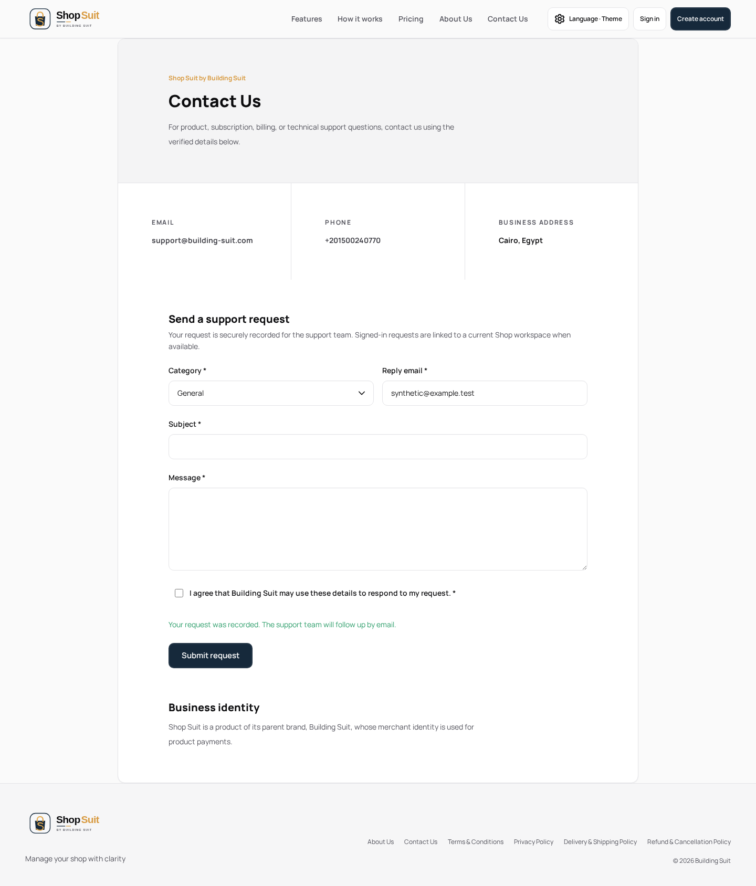
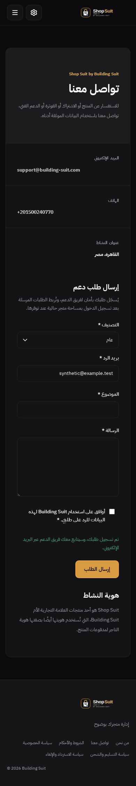
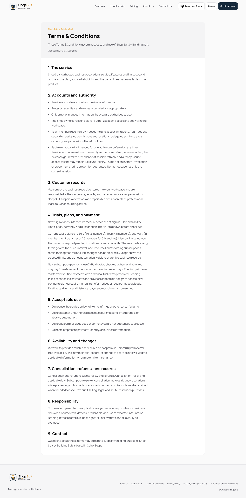
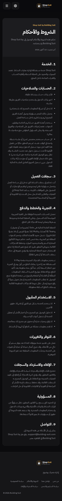

# Shop public non-landing states

Scope: `/about`, `/contact`, `/terms`, `/privacy`, `/delivery-shipping`, `/refund-cancellation`. Parent is the committed #299 checkpoint `6ff64ca`. Landing-page design, billing/subscription and shared auth/logout are excluded. No legal policy wording, provider contract, database or hosted settings change.

## Design plan and brief review

The required [official Anthropic frontend-design skill](https://github.com/anthropics/skills/blob/dbd4588f9e1033efb41dad4bef2f7947c8993d44/skills/frontend-design/SKILL.md) was read and applied before these edits. Its cloud-local text installation records the pinned revision and Apache-2.0 license; no installation scripts, packages or home resources were used. Earlier #297/#299 edits preceded acquisition and received retrospective review recorded in their checkpoint documentation.

Use the existing canonical token identity: Building Navy `#16293B`, Premium Gold `#D89B42`, Highlight Gold `#EBB45A`, Pearl White `#F7F8FA`, Soft Silver `#E2E5EA`, White `#FFFFFF`; keep existing semantic light/dark mappings. Manrope supplies Latin hierarchy; IBM Plex Arabic supplies Arabic hierarchy. Original Shop SVG wordmark stays in the shared public shell.

Contact layout: identity → contact details → request fields → explicit request action → business identity. Legal layout: identity/title/date → ordered titled sections, aligned to the locale reading direction with a 65ch maximum section measure. Brief review rejected a new marketing hero, typeface or palette: the approved Shop identity governs. Remove decorative all-caps/tracking, use the canonical title scale, and improve reading measure rather than invent unavailable design references. Existing legal wording remains authoritative content for this UI task.

## Changes and ownership

Shared `BsContactPage` uses the canonical display scale and limits introductory/identity prose to 65ch. `BsPublicLegalPage` limits policy sections to 65ch and wraps long content without horizontal overflow. The existing shared public identity remains sentence case. `BsSupportRequestForm` connects its required category field label and description to the PrimeVue input. Shop's domain command rejects reentry while an authoritative support request is pending; existing consent, validation, honeypot, rate-limit and bounded failure handling stay intact. Apps contain only data/props/events; no local presentation is introduced.

The shared public templates are consumed by Shop and Ledger. Both consumer typechecks are verification gates; the existing component contracts/catalogue examples remain unchanged.

## Evidence and limits

New synthetic EN light desktop and AR dark mobile cases cover label association, pending/inert submission, failure without private backend detail, retained input, rate-limit retry, successful clearing, RTL/LTR, no horizontal overflow and policy reading measure. Existing bilingual route metadata/link and contact validation/consent/honeypot/success/error assertions are retained. A direct command unit test proves duplicate submission issues one request while pending.

Screenshots below are synthetic implementation evidence. Public main-page/variant reference PNGs are unavailable; these are not pixel comparisons. All 26 in-scope design matrices remain incomplete, with 23 main-page PNGs missing and frozen source counts 33 main boards / zero complete matrices.

Local verification: five browser cases pass (two new EN/AR journeys and three retained route/contact regressions); five focused public/contact unit cases pass; full suite 1,403 passed / 23 skipped / zero failed; Shop and Ledger typechecks, Shop production build, workspace/token boundaries and changed app/UI/test lint pass. The initial exact message-label fixture locator omitted the required marker; it was corrected without removing assertions. Contact capture scroll is reset to avoid misplacing the sticky header in full-page evidence. CI results are recorded separately in the PR. Named functional journeys can be recorded complete only within the tested local scope; hosted delivery/authorization and full Penpot parity remain separate.

The seven named functional review buckets are now reviewed within their recorded scope; zero such buckets remain. This does not complete any Penpot design matrix or verify absent source pixels, hosted support delivery, payment/auth-owned journeys or deployment state.
