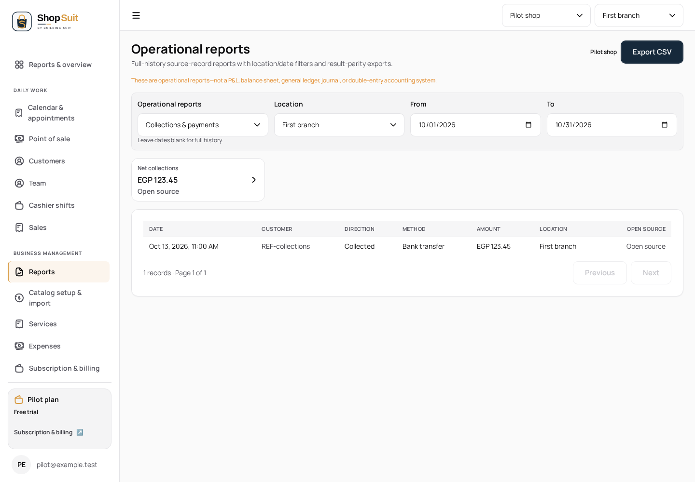
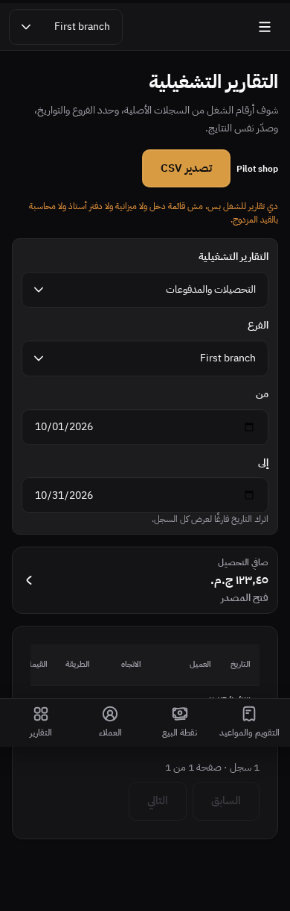
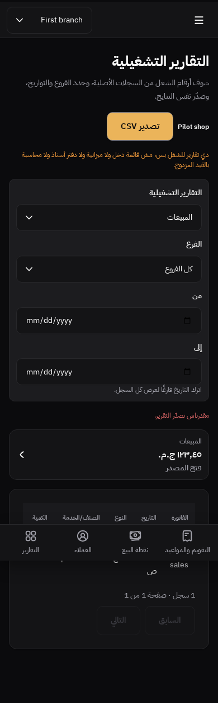

# Operational report variants checkpoint

Branch `codex/shop-suit/penpot-report-variants`, parent #295 (`938679c`). UI order remains #283 → #284 → #286 → #290 → #291 → #293 → #295 → this child. Held #292/#283 ancestry is unchanged; known duplicate-root policy is not bypassed or repeatedly rerun. No merge/deploy/hosted change.

## Supported requirement and changes

The frozen cumulative delta records seven additional kinds (collections, receivables, suppliers, expenses, inventory, margin, activity) and loading/failure/access-denied/cost-restricted/empty/exporting/export-failed states. IDs range from `9d8c9265-2366-809c-8008-c80d0225c567` through `9d8c9265-2366-809c-8008-c80fbdcbc8a6`. Existing sales plus these seven kinds already had authoritative queries/columns; they were not omitted published work. Their source PNGs are absent.

Concrete corrections:

- Retry now shows pending feedback without the stale read/export error alongside it. Results/summaries remain suppressed while reads are unresolved.
- Known item types, payment methods/directions, activity kinds and purchase statuses use existing localized labels or labels already used in purchasing. Unknown text retains its existing fallback; raw CSV codes/values remain unchanged.
- Snapshot inventory/receivables exports use their actual null date query bounds in filenames, rather than misleading retained disabled date-filter values.
- The semantic export command now shares the UI's read-readiness/error/result guards. Existing tenant/filter-version cancellation and multi-page export logic stay intact.

App code owns domain display values/commands; shared UI owns composition. No report calculations, money arithmetic, permission/schema/API contracts or CSV encoding changes. The financial-report branch for Ledger is untouched. Original brand/tokens and EN/AR direction remain. Landing, concurrent billing/subscription/auth/logout, reset SQL and SAS are excluded.

## Verification

New English light desktop and Arabic dark mobile fixtures traverse all eight report kinds, source links, location/date query bounds and snapshot disabled dates. Displayed known enums are localized while CSV keeps raw codes, exact values and formula protection. Denial and all four cost-restricted kinds issue no report query and expose no results/export. Empty results disable export. Retry suppresses stale errors/tables while pending. Export pending/failure/retry retains confirmed data. A 501-row export spans two authoritative pages; a changed report filter cancels the stale download.

Existing twelve EN/AR × light/dark × 390/768/1440 filter/pagination/CSV regression cases retain their assertions. Six reporting unit cases preserve scope/calculation/SQL contract evidence; they are not hosted SQL executions. Shop typecheck/build, boundaries/tokens and changed app/UI/test lint are the local gates. Final counts are recorded in the PR.

These inspected synthetic renders are implementation evidence, without corresponding reference PNGs. Fixtures make no upstream requests. Real hosted authorization/data parity is unclaimed. The long all-kinds test allows 90 seconds cumulative time for eight complete route/export journeys, with assertion limits unchanged.

Final validation: twelve new cases and twelve unchanged report regressions pass, six reporting unit cases pass, Shop typecheck/build and workspace/token checks pass, and changed app/UI/test lint passes. Four focused all-kind/pending-export cases were rerun after replacing the generic fixture summary with report-specific authoritative-shaped summary keys; they pass and supply the final screenshots. No production source changed after the final completed build.

## Completion accounting

Supported report kinds/access/read/export journeys join customer-profile lifecycle/allocation as functionally reviewed named flows. Retain them as complete within this recorded scope instead of reopening solely because exports are absent. Three functional review buckets remain: appointment scheduling variants, settings/admin completeness, and public non-landing contexts. Prior cash, inventory/purchasing and sales/receipt scopes are retained as verified.

Appearance comparison remains a separate blocker: 23 in-scope main-page PNGs missing, all 26 in-scope design matrices incomplete, frozen source 33 main boards / zero complete matrices. No missing board is invented, including the explicitly unsaved cash closed-history design. Original gap matrix and functional progress record implemented/tested/missing-source independently.

## CI harness correction

The inherited async-export unit harness supplied the default empty report while expecting pagination/download. The new semantic readiness guard correctly rejects that state. The harness now supplies a resolved non-empty report before exercising unchanged pagination, filter-version cancellation and disposal assertions. No production guard was relaxed. The five async-action cases pass locally; full-suite results are tracked separately from focused browser evidence.
