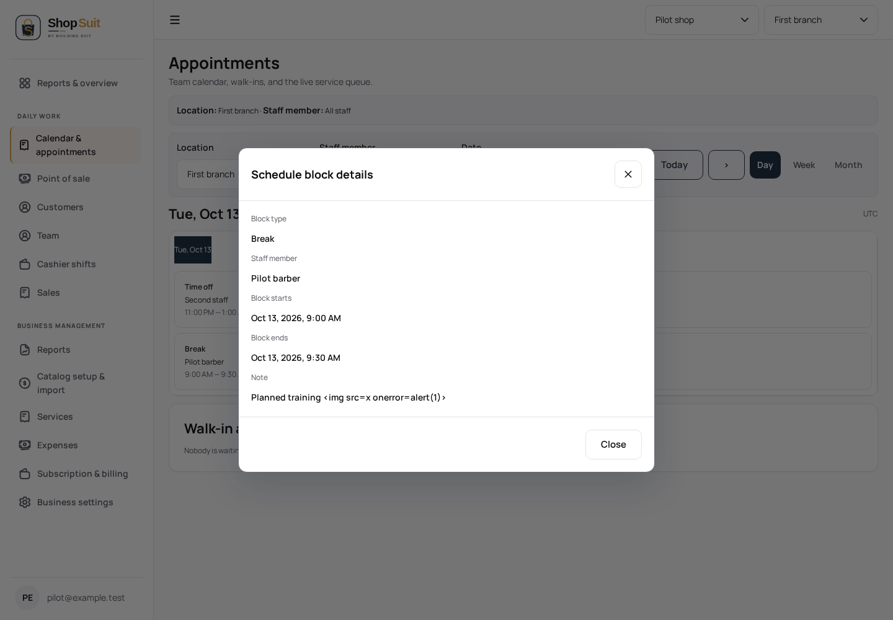

# Shop calendar schedule-block detail checkpoint

Branch `codex/shop-suit/penpot-schedule-block-detail`, parent draft #286 (`2f94a3c14957305e81a6cc6f04dba80450f820f0`). Merge order: #283 → #284 → #286 → this checkpoint. Independent dashboard navigation hotfix #289 remains separate; no cherry-pick or duplicate diff is included. Reconcile its shared root after its authorized staging integration.

## Evidence and gap

The materialized cumulative delta `Shop-Suit-Penpot-Delta-2026-10-13-0408.json` records schedule-block detail `9d8c9265-2366-809c-8008-c81b97292bc5` and schedule feedback states `9d8c9265-2366-809c-8008-c81becfacad9`, `9d8c9265-2366-809c-8008-c81bedd274c3`, `9d8c9265-2366-809c-8008-c81bee9333f8`. The frozen handoff contains no PNG of these states. This is saved state metadata, not visual comparison evidence or a complete design matrix.

The implementation already reads authorized schedule blocks alongside calendar appointments, but did not project or display them in day/week/month calendars. The omitted UI is an unimplemented saved state, not a missing published commit: the earlier ancestry audit found no missing PR278 or prior UI checkpoint ancestors.

## Bounded implementation

The app projects existing read data into kind/staff/time/full-date/note props. Shared UI renders block tiles, keeps block-only days visible on mobile, and opens a read-only details dialog using the shared overlay controller. No block editing or new backend operations are introduced. Staff filtering and the existing local-day overlap utility retain overnight and midnight boundary behavior. Pending, failed, location/date/staff changes dismiss stale detail. Notes use escaped interpolation.

The options read is now awaited before the dependent initial calendar read. The fixture exposed an initial empty snapshot before authorized location options resolved; awaiting that existing read allows the initial calendar request during SSR. Existing permission and data contracts remain unchanged.

Original brand, shared tokens and AR/EN RTL/LTR remain in use. Landing, subscription/billing, shared auth/logout, SQL reset and SAS are excluded.

## Verification and limits

Focused read-only fixture journeys cover English light desktop and Arabic dark mobile: initial calendar fetch, day/week/month, staff filter, overnight inclusion, midnight exclusion, detail/no write controls, escaped notes, Escape/focus return, pending read, failure/permission denied, stale dialog closure and retry. Existing owner appointment/schedule journeys exercise creation, status transitions and schedule save without changing their assertions. Unit overlap/calendar tests, Shop typecheck/build, shared boundary/token checks and changed-file lint are the focused gates. Exact counts are recorded in the PR after completion.

Synthetic browser renders below are inspected implementation evidence. No reference image exists for pixel comparison; no pixel-perfect or full-state parity claim is made. Hosted data, settings, deployment and merge are untouched.

