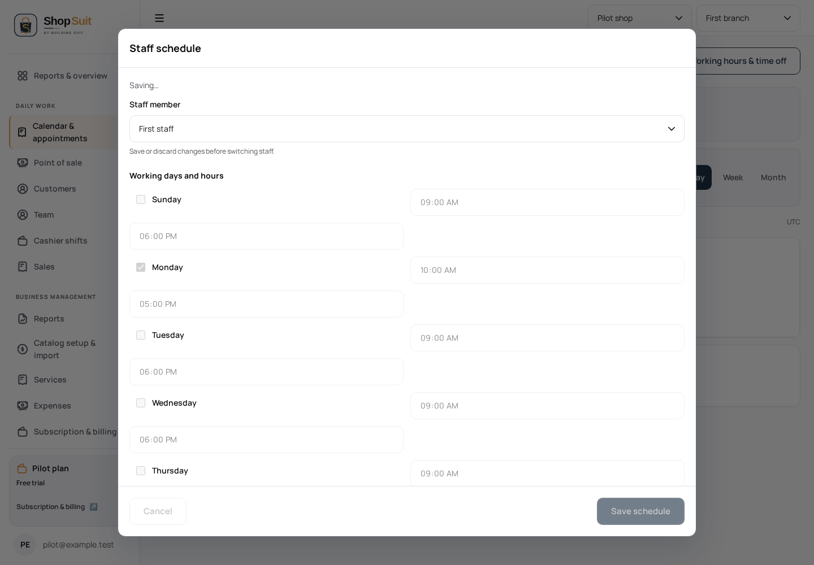
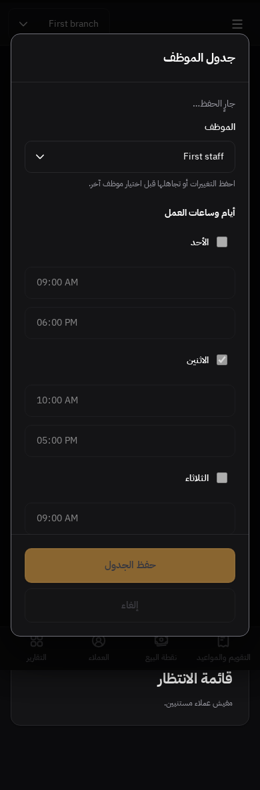

# Appointment schedule variants checkpoint

Branch `codex/shop-suit/penpot-schedule-variants`, parent #296 at `645b19c`. Existing UI chain is preserved; no UI staging merge, hosted mutation or deployment. #283's separately approved dependency rearrangement remains intact.

Saved appointment metadata explicitly requires working-hours/break/time-off forms, invalid/failed/pending/saved feedback, selected staff/location and read-only/no-context states. Schedule feedback IDs: `9d8c9265-2366-809c-8008-c81becfacad9`, `…c81bedd274c3`, `…c81bee9333f8`. Main/week/month/form/state pixels remain absent. This checkpoint completes named functional requirements without inventing appearance.

Concrete changes: clean staff changes refresh the shared record baseline, avoiding false dirty-close prompts. Dirty/pending schedules cannot switch staff and overwrite edits; the shared UI explains save/discard. Unadded block fields block schedule submission and explain the Add block step, avoiding silently dropped draft input. Existing shared task-scope capture prevents appointment save/status/schedule responses or confirmations from changing UI feedback after account/location/page context changes. Schedule submit retains its positive capability gate.

All valid payloads, working-hour/timezone calculations and server permission/conflict/idempotency rules remain unchanged. Apps own data/events/commands, shared UI owns the hints/disabled controls, and existing shared UX owns dirty/pending/focus/scope policy. No landing, concurrent billing/auth, reset SQL or SAS edits.

Browser journeys cover EN light desktop and AR dark mobile: clean staff baseline/close, dirty staff lock, invalid block, required staging, permission failure retaining edits, pending save/Escape protection and exact working-hours/time-off payload; no-shop/no-location/no-staff/read-only; options failure/retry; location query scope; and late success after SPA navigation without stale toast/dialog. Existing owner create/status/schedule journeys, #290 block/calendar checks and #291 edit/confirmation checkpoints remain evidence for previously completed flows. Initial dialog-close tests focused the select, whose own Escape handler consumes the key; moving focus to the unchanged time field tests the intended dialog close while keeping the no-discard assertion.

These inspected synthetic captures are implementation evidence; no comparable PNG is available. No upstream provider requests or hosted writes. Final test counts are recorded in the PR.

Appointment named calendar/create/edit/status/schedule/read-context flows are functionally reviewed; missing exports remain an independent appearance blocker. Remaining functional buckets: settings/admin and public non-landing. Prior completed report/profile, cash, inventory/purchasing and sales/receipt scopes are not reopened solely for absent pixels. Frozen counts remain 33 main boards / zero complete source matrices, with 26 in-scope matrices incomplete and 23 main PNGs absent.
