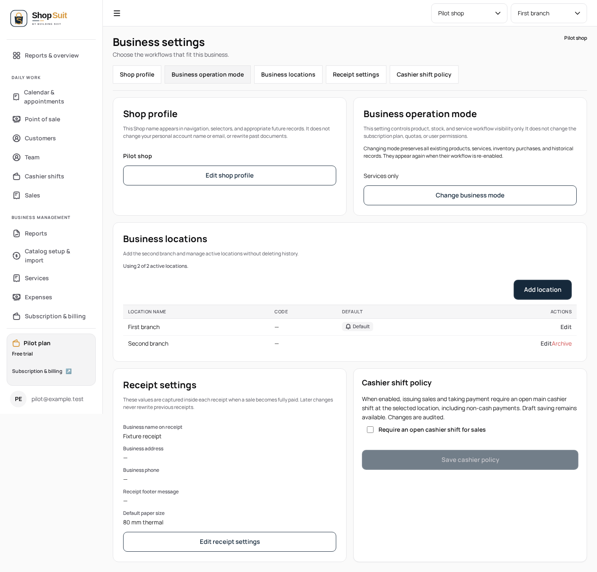
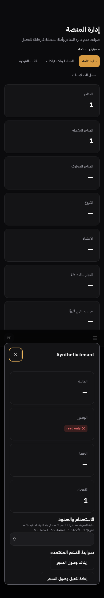

# Business settings and non-billing admin checkpoint

Branch `codex/shop-suit/penpot-settings-states`, parent #297 at `6afcd00`. UI chain/history is preserved; #283 is restored to staging after the separately approved #292 hotfix merge. No UI staging merge, hosted data/settings change or explicit deployment.

Saved requirements cover settings permission/loading/error/no-context, profile/mode/location/receipt/cash-policy workflows and platform session/operator/observer/detail/read states. Corresponding main/state/native PNGs are absent. Billing/subscription plan, payment-review/configuration and trial-changing commands remain owned by the concurrent billing work and are not edited or exercised as mutations here.

## Concrete corrections

Settings permission failures previously looked like confirmed read-only access, and some mode/location/receipt/cash panels remained visible during unresolved global reads. Permission pending/error now participates in capability and page-state projection; all setting panels wait for resolved context/access. Retry reloads context and permission reads, using accurate read-failure/no-context copy.

Platform session transport failures previously looked like confirmed access denial in production. They now receive bounded read-error feedback/retry; a successful null session retains the existing denied state. Tenant details are usable only for the selected ID after their read resolves successfully; explicit pending feedback suppresses stale errors and controls. No billing command, price, plan or backend permission behavior changes.

Apps retain data/typed commands; shared UI owns composition. Brand/tokens, EN/AR, RTL/LTR and original logos remain. Landing, shared auth/logout, reset SQL and SAS are excluded.

## Verification

Twenty-two new EN desktop/light and AR mobile/dark cases pass: failed settings permission/read-pending/retry, confirmed read-only/no-shop/capacity, independent receipt/cash read failures and retry, platform session error versus denial without raw debug disclosure, observer capabilities, tenant detail failure/pending/retry, and operator note/suspend/reactivate actions with exact scoped payloads and cancelled suspension producing no write. No billing/plan command is invoked by those operator cases. An initial table selector expected only tenant name while its accessible cell also contains ID; the locator now matches the visible identity without changing assertions.

Twelve unchanged profile/location/receipt settings scenarios pass across EN/AR × light/dark × 390/768/1440. Eleven profile/location/platform unit cases, Shop typecheck/build, boundaries/tokens and changed app/UI/test lint pass. These are local synthetic-provider checks, not hosted authorization proof. Final captures below are inspected implementation evidence; no reference comparison is possible.

## Skill source and remaining work

The required source is now resolved: Anthropic's official `frontend-design` skill was manually acquired as text into the cloud workspace and read at revision `dbd4588f9e1033efb41dad4bef2f7947c8993d44` (Apache-2.0). No installer scripts, external packages or home resources were used. It was unavailable during the initial changes; the retrospective review applies from acquisition onward. See [the pinned source](https://github.com/anthropics/skills/blob/dbd4588f9e1033efb41dad4bef2f7947c8993d44/skills/frontend-design/SKILL.md).

Retrospective screenshot review of #297 and #299: the original Shop SVG, Manrope/IBM Plex Arabic, token palette and RTL/LTR hierarchy remain. The mobile schedule dialog uses a bounded scroll region and persistent action footer; its pending staff controls and guidance identify the blocked action. Settings read states suppress stale editable panels. Admin detail pending/error gates suppress stale shop identity. Existing screenshots and browser assertions support these findings, rather than comparison with unavailable reference PNGs. The settings location-row action labels are visually close together; that shared table-wide spacing concern is recorded without expanding this read-state checkpoint into a global table redesign. Public non-landing work will keep this established identity, use readable text measure and form semantics, and preserve the existing legal wording.

Named settings and non-billing platform journeys are implemented/tested, with the required retrospective frontend-skill review now recorded. Public non-landing contexts remain the last unreviewed functional bucket. Prior completed appointment/report/profile/cash/inventory/purchasing/sales/receipt scopes remain recorded; unavailable PNGs do not reclassify them as missing code. All 26 in-scope design matrices stay incomplete, 23 main PNGs are absent, and frozen design counts stay 33 main boards / zero complete matrices.
