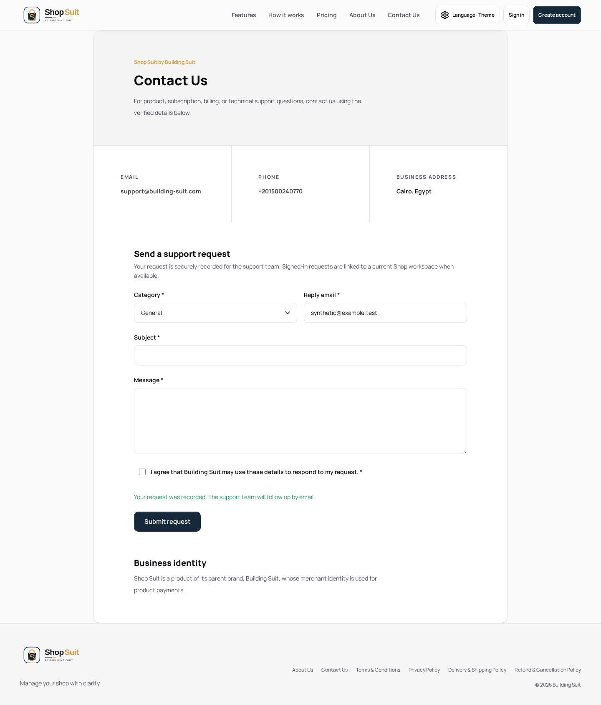
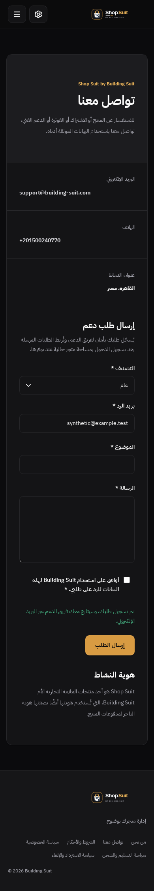

# Non-billing Shop UI staging integration

Prepared from staging `d1e753539e309e8342d547fd063128b7448c20bf`, with existing root #283 at `179e44e2960cd6a4b464f4fc5cfbdea0ea41fb20`. Normal merges combine the UI leaf and layout fix without rewriting any source branch. The UI-only prepared code candidate is `b839ca37b23fa82560399758a4ac0ec66e9a5fb4`; final staging integration must wait for the checkout-return hotfix and verify its resulting combined head.

| Included PR | Reviewed source head |
| --- | --- |
| [#283](https://github.com/Building-Suit/building-suit-monorepo/pull/283) | `179e44e2960cd6a4b464f4fc5cfbdea0ea41fb20` |
| [#284](https://github.com/Building-Suit/building-suit-monorepo/pull/284) | `42091550bd9ca746a3c50a33be6c5db70cbbfc47` |
| [#286](https://github.com/Building-Suit/building-suit-monorepo/pull/286) | `2f94a3c14957305e81a6cc6f04dba80450f820f0` |
| [#289](https://github.com/Building-Suit/building-suit-monorepo/pull/289) | `713a204e83621df1f5e360c003bc5cdd0921aedf` |
| [#290](https://github.com/Building-Suit/building-suit-monorepo/pull/290) | `d8c66102c4274622852807be9a678c84c5a06ef3` |
| [#291](https://github.com/Building-Suit/building-suit-monorepo/pull/291) | `f055e50c016ed0e2e4460480f5d5b8dc1ee63c99` |
| [#293](https://github.com/Building-Suit/building-suit-monorepo/pull/293) | `e5f43926671cc00d72275b434781dad8a42e2230` |
| [#295](https://github.com/Building-Suit/building-suit-monorepo/pull/295) | `938679cab2c67b00ddc8c2b36ed9e4c97363e2c6` |
| [#296](https://github.com/Building-Suit/building-suit-monorepo/pull/296) | `f82b25fd87ffd2c9878a2e8a29f362938df20a4d` |
| [#297](https://github.com/Building-Suit/building-suit-monorepo/pull/297) | `928f237a98886531731ff14a1f8577a263b6a831` |
| [#299](https://github.com/Building-Suit/building-suit-monorepo/pull/299) | `68f5beae39363ea10db6dc50e13f99299e787422` |
| [#300](https://github.com/Building-Suit/building-suit-monorepo/pull/300) | `0fdaecb40f55b3193c20feb9a5efe64ef742ee2d` |

Included scope: Team reference parity, import states, catalog dialog geometry/upload states, calendar blocks, appointment actions/schedules, cash actions, customer profiles, operational reports, settings/nonbilling admin reads, public non-landing states, and dashboard layout readiness.

Excluded: billing/proration #285/#287/#288/#298, unrelated SAS #294 and main promotion #215. Existing baseline XPay/auth changes remain intact; the prepared UI candidate has no diff against baseline in Supabase code/migrations/tests, billing.vue, BsBillingPage or billingPresentation. The independent #289 root presentation fix is explicitly included because its tested shared page-key handling resolves the reported dashboard shell mismatch; signup/recovery frame behavior remains covered.

## Hotfix coordination and release gates

The parent coordinated owner thread `01a13611-4da1-7655-a56f-90b16d28606e`. Its published hotfix #301 is `4de5c3a1ec8cd5cc21962bcf885ff6dd86bdaf13`, based on `d1e7535`. None of its uncommitted files were copied or modified. On resume, actual refs showed the earlier topology repair had not run: #283 and #301 were both staging roots. A normal merge into #283 produced `ba4429a8f88c47cd781f71d59d708bc1f8c1d84c`, and #283 was retargeted beneath #301. Both live policy checks passed; #301 full verification was restarted. The combined UI production-source head is `a885742253aae8e849bdb9f4b58d862a92be859d`, containing both that normal merge and the preserved prepared UI history. Its excluded billing/Supabase files match #301 exactly. Serialize UI staging delivery after #301 and verify the final root aggregate CI. Preserve one Shop staging root, matching-head merge checks, histories, branches and worktrees. Do not alter hosted security/provider settings or promote main.

The #293/#295 branch-policy failures were historical duplicate-root observations while #292/#283 were both roots. Live policy checks and reruns pass after the earlier authorized topology repair. GitHub protection-settings reads return 403; this task neither changes protections nor uses an admin/bypass merge.

## Evidence and limitations

Per-feature source comparisons, synthetic screenshots and test scope remain in their original work-package documents. Frozen Penpot counts remain 33 main boards / zero complete matrices; 23 in-scope main-page PNGs are absent and all 26 in-scope matrices remain incomplete. Named local journeys are reviewed; full pixel parity and hosted domain authorization/data behavior are not inferred from missing sources.

Final aggregate verification, exact published head, merge SHA and actual Vercel staging outcome are recorded in the root PR. Staging-only Git integration is the delivery mechanism; no manual production deployment, hosted security-setting change or migration deployer is introduced.

Inspected synthetic contact captures from the prepared combined build are stored separately, preserving earlier per-feature evidence. They demonstrate implementation rendering only; corresponding Penpot PNGs are absent.

## Independent combined-UI verification

The prepared production source passes Shop build/typecheck, workspace/token boundaries and the full unit suite (1,407 passed / 23 skipped). The initial operational browser run passed 113 of 114 cases; its remaining failure traced to malformed synthetic `platform_plan_read` data, not a production billing edit. The #299 fixture correction uses the established empty shop-plan contract and retains all command assertions, adds script-exception assertions, and passes all 22 affected settings/admin cases plus six repeated operator journeys. Five public cases and two delayed dashboard cases pass on the same build.

The reproducible final integration command is `pnpm exec playwright test -c apps/shop-suit/tests/e2e/ui-staging-integration.config.ts` (114 operational, five public non-landing and two dashboard cases). Required root CI remains an additional gate. Run these against the final combined hotfix/UI head and report that exact result rather than claiming the failed initial full operational run passed.

## Final combined-source browser result

All 121 cases in the consolidated configuration pass on `a885742253aae8e849bdb9f4b58d862a92be859d` (6.0 minutes): 114 operational, five public non-landing, and two delayed dashboard cases. All assertions remain, including the added operator script-exception check. Shop build passes on that combined source. Earlier per-feature design evidence is retained rather than overwritten by regenerated fixture PNGs. Subsequent integration-record changes affect documentation only; required full root CI verifies the final published head. Hosted migration/Edge delivery for #301 remains a separately coordinated hotfix-owner deployment operation, not a claim inferred from frontend CI.
